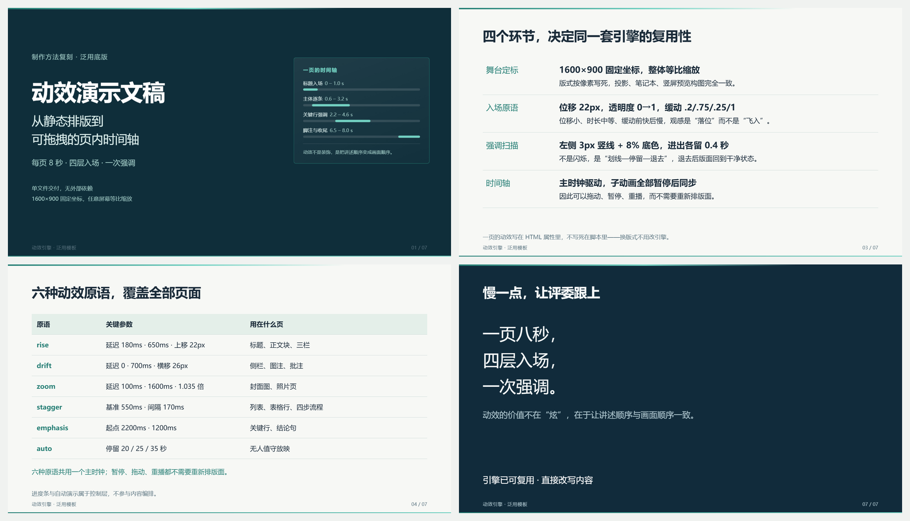

# ito-html-ppt

**用一份单文件 HTML，做出带页内动效、可拖时间轴、能直接打印 PDF 的演示文稿。**

不需要 PowerPoint，不需要任何 CDN，不需要联网。双击就能放映，拷到别人电脑上一样能播。



---

## 它是什么

一套「演示文稿引擎 + 13 种版式 + 自检脚本」的组合，产出一个 40 KB 左右的 HTML 文件：

- **1600×900 固定舞台**，任何屏幕只等比缩放，构图不跑版
- **页内动效**：逐层入场 + 关键行强调，按讲稿顺序排时间
- **可拖时间轴**：按 `P` 暂停、拖进度条回看、按 `R` 重播——动效不是只能从头播一遍
- **讲稿抽屉**：按 `N` 调出本页讲稿与依据，答辩前串场用
- **一键打印**：`@page 1600×900`，一页一张，动画冻结在末帧，不会出现半场画面
- **三种配色**：医院青 / 工程蓝 / 石墨灰，改 16 个 CSS 变量即可换肤

## 它不是什么

不是 `.pptx` 生成器，不替代 PowerPoint 的母版与协作能力；
不是通用前端框架，它只为「16:9 放映 + 打印留档」这一个场景优化；
不做响应式重排——版式按 1600×900 的像素写死，这是构图稳定的前提。

---

## 快速开始

### 1. 先看效果

直接双击打开 [`assets/example-deck.html`](assets/example-deck.html)。

```
空格 / →   下一页          ←   上一页
P          暂停页内动效      R   重播本页
M          关掉动效          A   自动演示
N          讲稿              F   全屏
```

### 2. 装成 WorkBuddy 技能

```bash
git clone https://github.com/<your-name>/ito-html-ppt.git
cp -r ito-html-ppt ~/.workbuddy/skills/
```

或者直接解压 [`dist/ito-html-ppt.skill`](dist/ito-html-ppt.skill)（就是个 zip）到 `~/.workbuddy/skills/`。

装好后说一句「**做一份 XX 主题的答辩稿**」，技能会自动触发，按 6 步流程产出。

### 3. 只要引擎

```bash
cp assets/deck-shell.html ./我的答辩稿.html
```

打开它，把占位首页换成自己的内容，版式片段从 [`references/layouts.md`](references/layouts.md) 复制。

---

## 目录结构

| 路径 | 说明 |
|---|---|
| `SKILL.md` | 技能主文件：6 步工作流、硬性规范、套模板方法 |
| `assets/deck-shell.html` | **可运行外壳**：全量 CSS + 引擎 + 控制层，页面处留空 |
| `assets/example-deck.html` | 7 页成品样例，已通过自检 |
| `references/layouts.md` | 13 种版式的 HTML 片段、容量上限、`data-*` 速查 |
| `references/engine-spec.md` | 四层架构、主时钟原理、参数基线、9 个坑 |
| `scripts/validate_deck.py` | 交付前自检：溢出 / 遮挡 / 报错 / 打印页数 |
| `dist/ito-html-ppt.skill` | 可直接安装的技能包 |

---

## 工作原理

### 四层

```
① 舞台层   #deck 写死 1600×900，fit() 只做整体 scale
② 版式层   浅色/深色两套皮肤 ＋ 每种版式一套 grid
③ 动效层   4 个入场原语 ＋ 强调 ＋ 主时钟同步
④ 控制层   时间轴 / 暂停 / 自动 / 讲稿 / 打印 / 键盘
```

### 主时钟（关键设计）

每个元素的动画创建后**立即暂停**，再由一个隐藏元素的空动画充当时间源，每帧把所有子动画的时间写成主时钟的时间：

```js
function anim(el, frames, delay, dur) {
  const a = el.animate(frames, {delay, duration:dur, fill:'both', easing});
  a.pause();                    // ← 关键
  a.currentTime = 0;
  effects.push(a);
}

driver = clockEl.animate([{opacity:0},{opacity:0}], {duration, fill:'both'});
driver.pause();

function sync() {
  const t = Math.min(duration, driver.currentTime);
  effects.forEach(a => a.currentTime = t);
}
```

让动画自己播，就只能从头看到尾；由主时钟驱动，才能**暂停在某一帧、拖动回看、整体重播**。这是"能动"和"能演"的区别。

### 参数基线

| 参数 | 取值 | 理由 |
|---|---|---|
| 画布 | 1600×900 | 16:9，与投影 1:1 |
| 入场位移 | ≤ 26 px | 再大就像"飞入" |
| 入场时长 | 550–850 ms | 短于 500 显仓促 |
| 缓动 | `cubic-bezier(.2,.75,.25,1)` | 前快后慢，落位感 |
| 交错间隔 | 170–250 ms | <150 糊成一片 |
| 强调 | 左侧 3px 竖线 + 8% 底色 | 划线—停留—退去 |
| 单页时长 | 8000 ms | 超过 10 s 观众开始等结尾 |

### 13 种版式

封面 / 问题页 / 价值行 / 依据行 / 四宫格 / 表格 / 四步流程 / 三栏阶段 / 左标题右条 / 左标题右块 / 图+文 / 两栏备查 / 收尾。

每种都附容量上限，超过就换版式，**不要靠缩字号硬塞**。

---

## 自检（交付前必跑）

```bash
python scripts/validate_deck.py 我的答辩稿.html --pdf 我的答辩稿.pdf
```

它会逐页激活、推到末帧、截图，并检查：

- `section` 数量与 `deck-data` 讲稿条数一致
- 控制台零报错
- 正文不越过底部 100 px 安全线、不压住脚注、右侧不越界
- 打印页数等于页数（验证 `@media print` 与 `beforeprint` 冻结末帧）

退出码 0 / 1，可以直接接进自动化流程。

---

## 兼容性

Chrome / Edge 100+，Firefox 103+。用 `file://` 直接打开即可，无需起服务器。

动画基于 Web Animations API；系统开启「减弱动态效果」时会自动关闭动效，元素仍然完整可见。

---

## License

MIT
